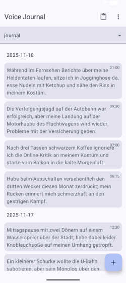

# Voice Journal

Voice Journal is a modern, privacy-focused Android journal, task, and appointment app built around effortless voice dictation. Capture thoughts hands-free, organize entries with smart voice-triggered categories, browse an interactive week/month calendar, log daily GPS routes, and manage your data locally or across your home network.



## Features

### 🎙️ Voice Dictation & Smart Categorization
* **Dual Speech Engines:**
  * **Android Built-in `SpeechRecognizer`:** Zero-configuration speech recognition with device-dependent offline support.
  * **Google Cloud Speech-to-Text API:** High-accuracy cloud recognition with configurable max recording duration, silence threshold, and silence timeout.
* **Smart First-Word Category Trigger:** Start a dictated entry with a category name or any of its comma-separated aliases (e.g., *"Todo Milch kaufen"* or *"Journal Heute war ein schöner Tag"*) to automatically assign the matching category and strip the trigger word.
* **Create or Append:** Dictate brand-new entries or append spoken text directly to a currently selected entry.
* **Quick Recording Shortcuts:** Long-press the **+** FAB for instant voice recording, expand the FAB menu to choose between manual text and voice input, or trigger dictation anytime from the optional **persistent quick-record notification**.

### 📅 Interactive Calendar (Week & Month Views)
* **Month & Week Views:** Seamlessly switch between a monthly overview and a horizontally swipeable week schedule with start/end time spans and automatic overlap layout.
* **Day Entries Preview Overlay:** Inspect all entries of a day in an animated preview overlay and jump directly to the corresponding position in the main timeline.

### 📝 Rich Entry & Category Management
* **Paged Timeline & Fast Scroller:** Entries are grouped by day using Paging 3 with a custom fast-scroll thumb and automatic scroll-to-entry navigation.
* **Full-Text Search:** Quickly find entries across your entire journal via the dedicated search screen.
* **Customizable Categories & Checklists:** Assign entries to multiple categories with custom colors, display order, voice aliases, optional date headers, and checkable To-Do items.
* **Travel-Aware Timezones:** Each entry stores its original IANA timezone (`zoneId`), preserving authentic local creation dates and times when traveling across timezones, with single and batch timezone editing.
* **Recycle Bin & Undo:** Soft-deleted entries can be undone immediately or restored / permanently deleted later from the built-in recycle bin (*"Gelöscht"*).
* **Google Photos Shortcut:** Long-press a date header or tap an entry's image indicator to jump straight to that day in Google Photos.

### 📤 Sharing, `.vj` Packages & Backups
* **Multi-Select Actions:** Long-press entries to batch-share as plain text, export as `.vj` files, update timezones, or delete/restore multiple entries at once, plus one-tap clipboard export.
* **Direct `.vj` Import:** Open or share `.vj` files from messengers or file managers directly into Voice Journal (`ImportActivity`) with schema and size validation, updating or merging entries without losing existing category assignments.
* **Full JSON Backup & Restore:** Export your entire database (categories + entries) to JSON (V3 format) and transactionally import V1/V2/V3 JSON or legacy text backups.

### 📍 Optional Background GPS Tracking
* **Periodic Route Logging:** Optionally log GPS track points in the background via `WorkManager` (configurable interval from 15 to 60 minutes) and survive device reboots.
* **Google Maps Route View:** Open your recorded daily path directly in Google Maps whenever GPS points exist for the selected date.

### 🌐 Embedded Local Network API Server
* **Ktor HTTP Server (`:8080`):** Optional foreground service exposing a RESTful JSON API (`GET`/`POST`/`PUT`/`DELETE` on `/categories` and `/journalentries`) on your local Wi-Fi network so desktop tools or local web clients can browse and edit entries.

### 🔒 Privacy & Security
* **Local-First Storage:** All journal entries, categories, and GPS points are stored locally on-device in Room with a strict zero-data-loss migration chain (`v1` → `v18`).
* **Encrypted API Key Storage:** Your optional Google Cloud API key is encrypted with a 256-bit `AES/GCM/NoPadding` Android Keystore key (`SecureApiKeyStore`) and excluded from cloud backups and device-to-device transfers.

## Tech Stack & Architecture

* **Platform:** Android 14+ (`minSdk = 34`, `targetSdk = 36`, `compileSdk = 36`)
* **Language:** Kotlin `2.2` with Coroutines & `StateFlow` / `Flow`
* **Architecture:** MVVM with Jetpack ViewModels and manual dependency injection (`Injector`)
* **UI:** Jetpack Compose, Material 3, Paging 3 Compose, localized resources (English & German)
* **Persistence:** Room (`2.8.x`) with exported schemas (`app/schemas/`)
* **Background & Location:** WorkManager + Google Play Services Location (`FusedLocationProviderClient`)
* **Networking & Serialization:** Embedded Ktor Server (`Netty`), `HttpURLConnection`, `kotlinx.serialization`

## Getting Started

### Build & Run
1. Clone the repository and open it in **Android Studio**.
2. Sync Gradle and run the `:app` configuration on a device or emulator running **Android 14 (API 34)** or higher, or build from the command line:
   ```bash
   ./gradlew :app:assembleDebug
   ```

### Permissions
Depending on which features you use, the app requests:
* **Microphone (`RECORD_AUDIO`):** Required for voice dictation.
* **Notifications (`POST_NOTIFICATIONS`):** For the quick-record shortcut notification and local web server foreground service.
* **Location (`ACCESS_FINE_LOCATION` / `ACCESS_COARSE_LOCATION` / `ACCESS_BACKGROUND_LOCATION`):** Optional, only needed if background GPS route tracking is enabled.
* **Internet & Network State:** Optional, used only for Google Cloud Speech-to-Text or the local network web server.

### Setting up Google Cloud Speech-to-Text (Optional)
To use the Google Cloud engine instead of Android's built-in speech recognizer:
1. Open the [Google Cloud Console](https://console.cloud.google.com/) and create or select a project with billing enabled.
2. Navigate to **APIs & Services → Library**, search for **Cloud Speech-to-Text API**, and enable it.
3. Navigate to **APIs & Services → Credentials → Create Credentials → API Key**.
   * *Recommended:* Restrict the key to **Cloud Speech-to-Text API**.
4. In Voice Journal, open **Settings**, select **Google Cloud Speech-to-Text**, paste your API key, and adjust recording duration and silence detection thresholds if desired.

## Usage Quick Tips

1. **Quick Voice Entry:** Long-press the **+** button (or tap **+** → microphone icon) and speak.
   * *"Todo Milch kaufen"* → Creates `"Milch kaufen"` in category **Todo**.
   * *"Journal Heute war ein schöner Tag"* → Creates `"Heute war ein schöner Tag"` in category **Journal**.
2. **Append by Voice:** Tap an existing entry to select it, then trigger voice recording to append dictated text to that entry.
3. **Batch Operations:** Long-press one or more entries to share them as text, export a `.vj` file, change their timezone, or move them to the recycle bin.

## License

Voice Journal is licensed under the MIT License.
